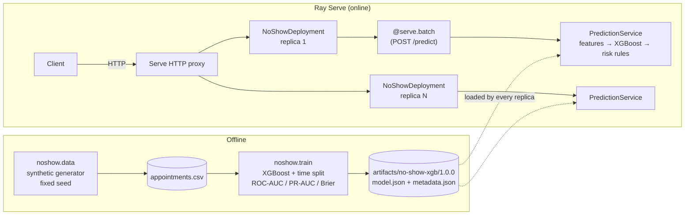

# Clinic No-Show Prediction

A microservice that takes a scheduled appointment and returns the probability
that the patient will **not show up**, together with a risk level and a
suggested action. It uses an XGBoost model served in real time with
**Ray Serve** (FastAPI ingress, dynamic request batching, configurable
replicas). Latency and throughput were measured on a laptop with an async load
generator and Locust.

> **Demo project with synthetic data.** All data is generated by a script in
> this repository with a fixed seed. No real patient data is used. This is
> not a medical device and it makes no clinical decisions. The output is an
> operational signal for scheduling, for example whether to ask for a
> confirmation.

## The problem

Missed appointments are expensive for outpatient clinics. The slot goes
unused, the professional's time is lost, and other patients wait longer.
Clinics usually react with blanket reminders. A risk score lets them focus
the costlier actions, such as an explicit confirmation request, a phone call
or offering the slot to a waitlist, on the appointments most likely to be
missed. Two calls cover the use cases:

- `POST /predict`: score one appointment when it is booked or shown on the
  scheduling screen.
- `POST /predict/batch`: score a whole agenda, for example from a nightly
  job that decides who gets a confirmation call tomorrow.

## Architecture



- **`PredictionService`** (`src/noshow/service.py`) contains the prediction
  logic and has no Ray or HTTP dependency, so it is unit-tested directly.
- **`NoShowDeployment`** (`src/noshow/serve_app.py`) is a thin Ray Serve
  wrapper that adds replicas and `@serve.batch`.
- **`noshow.api`** exposes the same routes as a plain FastAPI app. The API
  tests use it, and it serves as the no-Ray baseline in the benchmarks.

## Guided tour

The `docs/` folder explains the project one part at a time, in reading order:

1. [Synthetic data generation](docs/01-data-generation.md): how the
   simulated clinic produces a learnable but noisy signal without leakage.
2. [Feature engineering](docs/02-features.md): one feature module, a pandas
   path for training, a NumPy fast path for serving, and the parity test that
   keeps them equal.
3. [Training and evaluation](docs/03-training.md): time-based split,
   ROC-AUC, PR-AUC, Brier score, reliability table, and the versioned
   artifact.
4. [Serving with Ray Serve](docs/04-serving.md): FastAPI ingress, dynamic
   batching, replicas, what `inference_time_ms` measures, and risk
   thresholds.
5. [Load testing and benchmarks](docs/05-benchmarks.md): how the load tests
   work and how to read them. Raw numbers are in
   [docs/benchmarks.md](docs/benchmarks.md).
6. [Deployment: Docker, compose and CI](docs/06-deployment.md)

## How to run

Requires Python 3.11+.

```bash
python -m venv .venv && source .venv/bin/activate   # Windows: .venv\Scripts\activate
pip install -e ".[dev,bench]"

python -m noshow.data  --out data/appointments.csv          # 1. synthetic data
python -m noshow.train --data data/appointments.csv --version 1.0.0   # 2. train + metrics
NUM_REPLICAS=2 python -m noshow.serve_app                  # 3. serve on :8000
# or: serve run serve_config.yaml
```

Tests and lint:

```bash
ruff check . && ruff format --check .
pytest -q                 # unit + API tests (no Ray needed)
pytest -m integration -q  # starts a real 2-replica Ray Serve app
```

Docker:

```bash
docker compose up --build   # builds the image (trains the model inside) and serves on :8000
```

The Dockerfile and compose file were **not run** on the development machine,
because the Docker engine there was not available. See
[docs/06-deployment.md](docs/06-deployment.md).

Configuration is done with environment variables (see
[`.env.example`](.env.example)): `NUM_REPLICAS`, `MAX_BATCH_SIZE`,
`BATCH_WAIT_TIMEOUT_S`, `MAX_ONGOING_REQUESTS`, `MODEL_THREADS`, `MODEL_DIR`,
`SERVE_HOST`, `SERVE_PORT` and `ACCESS_LOG`.

## API examples

```bash
curl -s localhost:8000/predict -H 'content-type: application/json' -d '{
  "appointment_id": "apt-1",
  "booked_at": "2025-03-03T09:00:00",
  "scheduled_at": "2025-03-10T14:30:00",
  "confirmed": false,
  "prior_appointments": 4,
  "prior_no_shows": 2,
  "prior_cancellations": 0,
  "days_since_last_visit": 60
}'
```

```json
{
  "appointment_id": "apt-1",
  "no_show_probability": 0.38305,
  "risk_level": "medium",
  "recommended_action": "Request explicit confirmation (SMS/WhatsApp) 48h before the appointment.",
  "model_version": "1.0.0",
  "inference_time_ms": 23.284
}
```

```bash
curl -s localhost:8000/predict/batch -H 'content-type: application/json' \
  -d '{"appointments": [ {...}, {...} ]}'
# -> {"predictions": [...], "model_version": "1.0.0", "inference_time_ms": ...}
```

The history fields (`prior_*`, `days_since_last_visit`) must describe the
patient **as of booking time**. Invalid input returns 422, for example
`scheduled_at` before `booked_at`, or more no-shows than past appointments.
OpenAPI docs are served at `/docs`.

### Risk levels

| risk_level | probability | recommended_action |
|---|---|---|
| `low` | `< 0.20` | Send the standard automatic reminder. |
| `medium` | `0.20 ≤ p < 0.45` | Request explicit confirmation (SMS/WhatsApp) 48h before the appointment. |
| `high` | `≥ 0.45` | Call the patient to confirm and consider offering the slot to the waitlist. |

Lower bounds are inclusive, and boundary tests cover them. The thresholds
are demo values tied to the synthetic base rate of about 22% (see
[docs/04-serving.md](docs/04-serving.md)).

## Model results (synthetic test set, time-based split)

| metric | value | reference |
|---|---|---|
| ROC-AUC | 0.7727 | 0.5 = random |
| PR-AUC | 0.4889 | 0.2171 = base rate |
| Brier score | 0.1413 | 0.1700 = always predicting the base rate |

The test set holds the most recent 20% of appointments (9,978 rows). The full
output and the reliability table are in
[docs/03-training.md](docs/03-training.md). These numbers show how well the
model recovers a process this project designed. They do not predict
performance on real clinic data.

## Benchmarks

Measured on an Intel i7-1185G7 laptop (4 cores / 8 threads, 39.7 GB RAM,
Windows 11, Python 3.13.1, Ray 2.60.1), with the load generator on the same
machine and other applications running. Full raw output, commands and
caveats are in [docs/benchmarks.md](docs/benchmarks.md). The method is in
[docs/05-benchmarks.md](docs/05-benchmarks.md).

```bash
SERVE_PORT=8710 python -m bench.run_benchmarks --configs 1x1 1x32 2x32 4x32 --duration 15 --locust --uvicorn-baseline
python -m bench.microbench --repeat 300
```

Selected rows, pass 1 / pass 2 (config = replicas × max batch size; latencies
are client-side):

| scenario | config | tool | req/s | predictions/s | p50 ms | p95 ms | p99 ms |
|---|---|---|---|---|---|---|---|
| `/predict`, 1 client | 1x1 | loadtest | 59.1 / 61.4 | 59.1 / 61.4 | 16.51 / 16.27 | 21.18 / 18.94 | 29.54 / 21.3 |
| `/predict`, 1 client | 1x32 | loadtest | 31.5 / 40.2 | 31.5 / 40.2 | 31.57 / 30.62 | 33.91 / 32.2 | 39.44 / 32.99 |
| `/predict`, 32 clients | 1x32 | Locust | 97.8 / 100.5 | 97.8 / 100.5 | 330 / 310 | 350 / 390 | 360 / 420 |
| `/predict`, 32 clients | 2x32 | Locust | 108.4 / 127.5 | 108.4 / 127.5 | 290 / 240 | 350 / 290 | 410 / 400 |
| `/predict/batch` 50 rows, 8 clients | 1x32 | Locust | 128.8 / 135.5 | 6440.0 / 6775.0 | 61 / 55 | 73 / 81 | 82 / 98 |
| `/predict/batch` 50 rows, 8 clients | 2x32 | Locust | 157.6 / 150.2 | 7880.0 / 7510.0 | 50 / 51 | 61 / 68 | 66 / 81 |
| `/predict/batch` 500 rows, 4 clients | 1x32 | loadtest | 44.3 / 54.3 | 22133.3 / 27166.7 | 83.08 / 64.08 | 115.96 / 98.2 | 141.59 / 359.83 |
| `/predict/batch` 500 rows, 4 clients | 2x32 | loadtest | 58.2 / 65.9 | 29100.0 / 32966.7 | 59.15 / 51.48 | 85.97 / 70.15 | 357.98 / 347.07 |
| `/predict/batch` 500 rows, 4 clients | 4x32 | loadtest | 55.1 / 64.0 | 27533.3 / 32000.0 | 66.08 / 56.89 | 97.86 / 77.7 | 117.75 / 90.19 |
| `/predict`, 32 clients (no Ray) | uvicorn, 1 process | Locust | 733.8 / 810.0 | 733.8 / 810.0 | 41 / 38 | 55 / 49 | 66 / 62 |

In-process inference (median, 1 thread): the pandas feature path plus the
model took 12.713 ms for 1 row. The NumPy fast path took 1.419 ms for 1 row
and 2.343 ms for 50 rows.

**What this shows, honestly:**

- **Horizontal scaling works where the replica does the work.** For 500-row
  batches, going from 1 to 2 replicas raised throughput by +31% (pass 1) and
  +21% (pass 2). Going to 4 replicas gave nothing more on a 4-core laptop
  that also runs the proxy and the load generator.
- **On this machine, single-request traffic is limited by the Ray Serve
  proxy hop** (about 15 ms per request; 69.5–129.4 req/s across all Serve
  configurations), not by the model (about 2 ms). A single uvicorn process
  without Ray was faster for this workload on one laptop. Ray Serve's
  benefits (replicas across processes and nodes, declarative scaling) need
  more hardware than one 4-core laptop to pay off.
- **Dynamic batching (`@serve.batch`) gave no consistent throughput gain**
  here, because the model call was not the bottleneck. It added about 14–15 ms
  to a lone request, more than the configured 5 ms wait (likely Windows
  timer granularity; not verified).
- **The biggest win was the inference fast path** (about 9x less
  per-request compute) **and client-side batching** (up to 32,966.7
  predictions/s with 500 rows per request).

## Design decisions and trade-offs

- **Ray Serve rather than a plain uvicorn app.** Replicas, dynamic batching
  and declarative config (`serve_config.yaml`) come from the framework, and
  the same code scales from a laptop to a Ray cluster. The cost is an extra
  network hop through the Serve proxy, and on a single small machine that
  hop dominates latency. The benchmarks measure this with a uvicorn
  baseline.
- **Logic outside the framework.** `PredictionService` knows nothing about
  Ray or HTTP. Tests run in seconds without a cluster, and the Serve layer
  stays about 100 lines.
- **Two feature implementations, one parity test.** pandas is convenient
  for training. For a 1-row request it added about 11 ms, several times the
  cost of the model call, so serving uses a NumPy path. A test asserts both produce
  identical features.
- **`/predict/batch` bypasses `@serve.batch`.** The client already sent many
  rows, so they are scored in one call.
- **One XGBoost thread per replica.** Parallelism comes from replicas, which
  keeps the replica comparison honest.
- **Time-based split and as-of-booking history features.** These avoid the
  two most common ways to overstate a no-show model: training on the future,
  and counting the current appointment in the patient's history.
- **Model built at Docker build time.** The image is self-contained and
  reproducible without committing binaries. A real system would pull a
  registered model version instead.

## Limitations

- Synthetic data only. Metrics and thresholds say nothing about real clinics.
- No authentication, rate limiting or multi-tenant isolation.
- No model registry or monitoring: the model version is a directory name,
  and there is no drift detection.
- Benchmarks ran on one shared Windows laptop with other applications
  running, with the load generator on the same machine. Absolute numbers are
  pessimistic and noisy (see [docs/benchmarks.md](docs/benchmarks.md)).
- Docker and compose files were not run on the development machine.
- The top decile of predictions is slightly over-confident. No post-hoc
  calibration is applied.

## Future work

- Register models in MLflow and load them by version or alias.
- Serve features from an online store (e.g. Feast + Redis) so clients send
  only an `appointment_id` and `patient_id` instead of the history counters.
- Post-hoc calibration (isotonic) and threshold selection from a cost matrix
  (cost of an empty slot vs cost of a call).
- Benchmark on Linux, with the load generator on a separate machine, and
  with Serve autoscaling (`autoscaling_config`) instead of fixed replicas.
- Monitoring: prediction distribution and calibration drift over time.

## License

[MIT](LICENSE)
